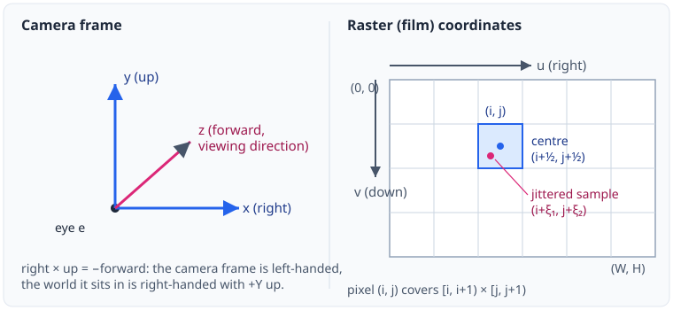
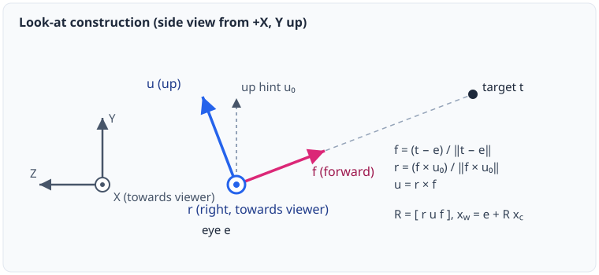
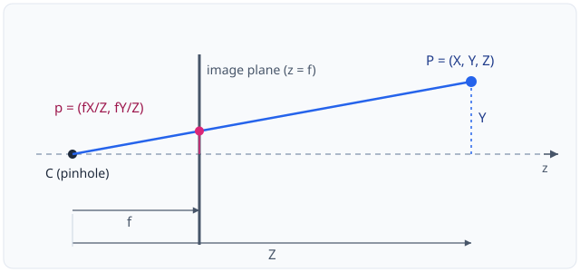
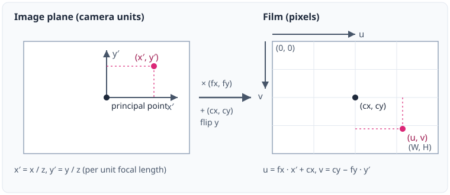
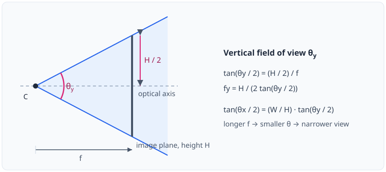
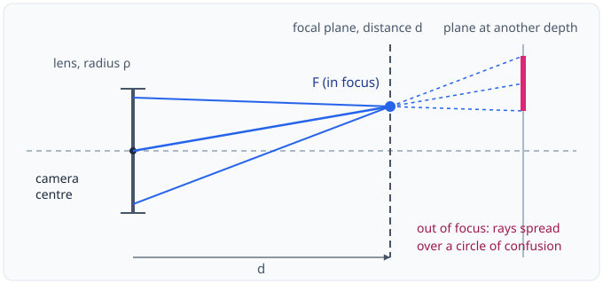
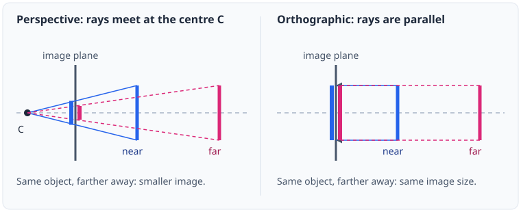
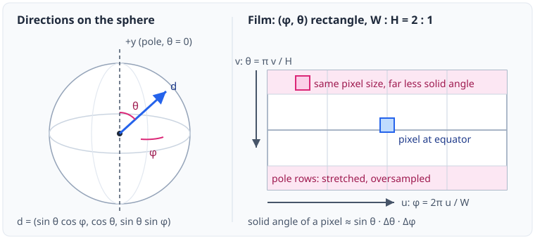
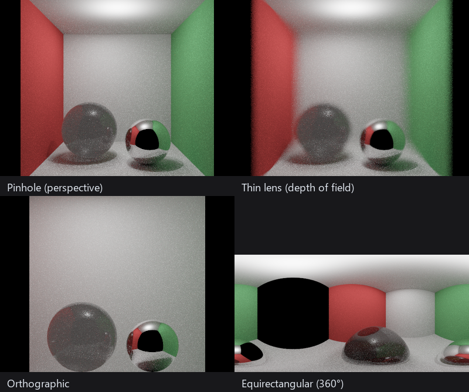

# Camera Models for Ray-Based Rendering

This document explains the theory behind the cameras of a ray-based renderer: how a position on the
film becomes a ray, and why the description of a camera splits into *extrinsics* (where it is) and
*intrinsics* (how it projects). It covers the pinhole (perspective) model, the thin-lens extension that
produces depth of field, the orthographic model and the equirectangular panorama. Implementation detail
is intentionally out of scope; the short [mapping to the code](#9-mapping-to-the-code) at the end only
says which type realises which concept.

## Contents

1. [Cameras as ray generators](#1-cameras-as-ray-generators)
2. [Coordinate frames and conventions](#2-coordinate-frames-and-conventions)
3. [Extrinsics: placing the camera](#3-extrinsics-placing-the-camera)
4. [Intrinsics and the pinhole model](#4-intrinsics-and-the-pinhole-model)
5. [Generating rays from pixels](#5-generating-rays-from-pixels)
6. [Thin lens and depth of field](#6-thin-lens-and-depth-of-field)
7. [Orthographic projection](#7-orthographic-projection)
8. [Equirectangular (spherical) projection](#8-equirectangular-spherical-projection)
9. [Mapping to the code](#9-mapping-to-the-code)
10. [References](#10-references)

---

## 1. Cameras as ray generators

A camera model describes a mapping between points of the scene and positions on the film. Classical
computer vision uses it forwards (**projection**: world point to pixel). A ray-based renderer needs the
inverse: for every film position $(u, v)$ it must produce the **ray** along which light reaches that
position, and the radiance carried by the ray is what gets recorded.

A camera therefore has two jobs:

- **Ray generation**: $(u, v) \mapsto \mathbf{r}(t) = \mathbf{o} + t\,\mathbf{d}$.
- **Projection** (the forward map), used for debugging, calibration and reprojection.

The inverse of projection is not a function of the pixel alone: a pixel corresponds to a whole ray, and
the depth along it is unknown. This is why the inverse of a camera is a ray generator and not a point
generator.

Both jobs depend on two kinds of parameters that are kept separate:

| Parameters | Question they answer | Depend on |
|---|---|---|
| **Extrinsics** | Where is the camera and which way is it facing? | Placement only |
| **Intrinsics** | How does a direction in the camera's own frame map to a film position? | The projection model and the sensor |

The separation is what lets the same placement be used with a pinhole, an orthographic or a panoramic
projection, and the same lens be moved around the scene.

## 2. Coordinate frames and conventions

Three frames are involved.

| Frame | Axes | Units |
|---|---|---|
| **World** | right-handed, $+Y$ up | scene units |
| **Camera** | $+x$ right, $+y$ up, $+z$ forward (viewing direction) | scene units |
| **Raster** | $+u$ right, $+v$ down, origin at the top-left corner of the image | pixels |

Three conventions deserve to be stated explicitly because mixing them is the usual source of mirrored,
flipped or half-pixel-shifted images.

**Handedness.** The camera triple $(\mathbf{r}, \mathbf{u}, \mathbf{f})$ = (right, up, forward) satisfies
$\mathbf{r} \times \mathbf{u} = -\mathbf{f}$, so the camera frame is left-handed, as in PBRT and DirectX.
With a right-handed world the default camera looks down $-Z$. Nothing depends on this choice, but every
formula below assumes it.

**Raster $v$ points down.** Camera $+y$ points up, so converting between the two flips the sign of the
vertical term. Textbook formulas for the calibration matrix assume a camera frame with $y$ down and
therefore do not contain the sign flip; here it appears explicitly.

**Continuous raster coordinates.** Pixel $(i, j)$ is the unit square $[i, i+1) \times [j, j+1)$ and its
centre is $(i + \tfrac12,\, j + \tfrac12)$. A film position is a real number, not an integer index. This
matters in two places:

- a Monte Carlo estimator draws positions *anywhere inside* the square, $u = i + \xi_1$, $v = j + \xi_2$
  with $\xi \in [0, 1)$;
- adding the $\tfrac12$ offset a second time (once by the caller, once inside the camera) shifts the whole
  image by half a pixel towards the bottom-right.

  
   <em>Figure 1. Camera frame (left) and raster coordinates (right). The pixel centre sits at half-integer
  coordinates; a Monte Carlo sample is a random point inside the pixel's unit square.</em>

## 3. Extrinsics: placing the camera

The extrinsics are a rigid transformation: a position $\mathbf{e} \in \mathbb{R}^3$ and an orthonormal
basis $R = [\mathbf{r}\ \ \mathbf{u}\ \ \mathbf{f}]$ whose columns are the camera axes written in world
coordinates. They map a point from camera space to world space and back:

$$
\mathbf{x}_w = \mathbf{e} + R\,\mathbf{x}_c,
\qquad
\mathbf{x}_c = R^{\top}(\mathbf{x}_w - \mathbf{e}).
$$

Directions transform with $R$ only, since translations do not affect them: $\mathbf{d}_w = R\,\mathbf{d}_c$.
In the vocabulary of calibration, $(R, \mathbf{e})$ is the camera-to-world transform and its inverse
$[R^{\top} \mid -R^{\top}\mathbf{e}]$ is the world-to-camera ("extrinsic matrix").

**Look-at construction.** A camera is usually specified by an eye point $\mathbf{e}$, a target $\mathbf{t}$
and an approximate up vector $\mathbf{u}_0$:

$$
\mathbf{f} = \frac{\mathbf{t} - \mathbf{e}}{\lVert \mathbf{t} - \mathbf{e} \rVert},
\qquad
\mathbf{r} = \frac{\mathbf{f} \times \mathbf{u}_0}{\lVert \mathbf{f} \times \mathbf{u}_0 \rVert},
\qquad
\mathbf{u} = \mathbf{r} \times \mathbf{f}.
$$

The last step re-orthogonalises the up vector, so $\mathbf{u}_0$ only needs to be roughly "up". The
construction degenerates when $\mathbf{u}_0 \parallel \mathbf{f}$ (looking straight up or down): the cross
product vanishes and the roll of the camera is undefined, so a different reference vector has to be chosen.

  
   <em>Figure 2. Look-at construction (side view). Forward points from the eye to the target; right is
  perpendicular to both forward and the up hint; the camera up completes the orthonormal frame.</em>

The extrinsics are **identical for every camera model.** A pinhole, an orthographic sensor and a 360°
panorama are all rigid bodies with 6 degrees of freedom; what differs is only how each one interprets the
axes of its own frame (Sections 4–8). Time-varying extrinsics, needed for motion blur, interpolate between
two such poses; they are not covered here.

## 4. Intrinsics and the pinhole model

The pinhole camera is an opaque box with an infinitesimal hole at the camera centre $C$. Every point of the
scene sends exactly one ray through $C$, and the image forms on a plane at distance $f$ behind it. To avoid
the inverted image, the plane is conventionally placed *in front of* the hole at $z = f$.

  
   <em>Figure 3. Pinhole projection. Similar triangles give y / f = Y / Z.</em>

From similar triangles in Figure 3, a camera-space point $(x, y, z)$ with $z > 0$ projects to

$$
x' = f\,\frac{x}{z}, \qquad y' = f\,\frac{y}{z}.
$$

This is **perspective projection**: the image coordinates are the camera-space coordinates divided by
depth, so objects appear smaller the farther away they are, and lines through the camera centre collapse to
points. Two properties follow directly: parallel lines that are not parallel to the image plane converge
at a vanishing point, and depth information is lost, since all points on a ray project to the same place.

### 4.1 From the image plane to pixels

The image plane has physical units; the film is addressed in pixels. The conversion has four parameters,
the **intrinsic parameters**:

- $f_x, f_y$: focal length measured in pixels along each axis ($f_x = f_y$ for square pixels);
- $(c_x, c_y)$: the **principal point**, the pixel where the optical axis meets the film, normally the
  image centre $(W/2, H/2)$.

With the vertical flip of Section 2:

$$
u = f_x\,\frac{x}{z} + c_x,
\qquad
v = c_y - f_y\,\frac{y}{z}.
$$

  
   <em>Figure 4. From the image plane to pixels: scale by the focal lengths in pixels, shift the origin to
  the top-left corner via the principal point, and flip the vertical axis.</em>

In homogeneous coordinates this is the familiar calibration matrix

$$
K = \begin{pmatrix} f_x & 0 & c_x \\ 0 & f_y & c_y \\ 0 & 0 & 1 \end{pmatrix},
\qquad
\lambda \begin{pmatrix} u \\ v \\ 1 \end{pmatrix}
= K\,\operatorname{diag}(1, -1, 1)\,R^{\top}(\mathbf{x}_w - \mathbf{e}),
$$

where $\lambda = z$ is the depth and $\operatorname{diag}(1,-1,1)$ is the flip that accounts for camera $y$
pointing up. The matrix $K$ is the *entire* intrinsic description of an ideal pinhole camera; combined with
the extrinsics it gives the full projection $P = K\,[R^{\top} \mid -R^{\top}\mathbf{e}]$.

Real calibrated cameras add a skew term $K_{12}$ (non-orthogonal pixel axes) and lens distortion
(radial and tangential). Both are omitted here; they are the natural extension points of the
intrinsics.

### 4.2 Field of view

A rendering is usually specified by field of view rather than focal length in pixels. For an image of
$H$ pixels, with vertical field of view $\theta_y$:

$$
f_y = \frac{H}{2\tan(\theta_y / 2)},
\qquad
\tan\frac{\theta_x}{2} = \frac{W}{H}\tan\frac{\theta_y}{2}
\quad (\text{square pixels, } f_x = f_y).
$$

  
   <em>Figure 5. Vertical field of view. The image height H seen from distance f subtends the angle
  θy.</em>

The field of view must always say *which* angle it is: vertical, horizontal and diagonal values differ,
and quoting one while implementing another changes the framing by the aspect ratio. Larger $\theta$ means
shorter focal length and stronger perspective distortion at the edges of the frame.

## 5. Generating rays from pixels

Ray generation inverts the projection of Section 4.1 for a film position $(u, v)$. First the direction in
camera space (with $z = 1$ the depth-normalised point on the image plane), then the world-space ray:

$$
\mathbf{d}_c = \left( \frac{u - c_x}{f_x},\ \frac{c_y - v}{f_y},\ 1 \right),
\qquad
\mathbf{o} = \mathbf{e},
\qquad
\mathbf{d} = \frac{R\,\mathbf{d}_c}{\lVert R\,\mathbf{d}_c \rVert}.
$$

Two remarks:

- **Depth versus distance.** Projection divides by the camera-space depth $z$, which is measured along the
  optical axis. The ray parameter $t$ of a hit measures *Euclidean distance* along the (normalised) ray.
  They are related by $z = t\,(\mathbf{d} \cdot \mathbf{f})$, so a depth map and a distance map of the same
  scene are not the same image. Mixing them up is a common source of curved walls in "flat" renderings.
- **Pixel area.** A pixel value is the average radiance over its footprint, $L_{ij} = \int_{\text{pixel}}
  L(u, v)\,\mathrm{d}u\,\mathrm{d}v$, estimated by averaging rays over jittered positions inside the
  unit square. Choosing where inside the pixel to sample, and how to weight the samples, is the
  reconstruction-filter question; it does not belong to the camera model.

## 6. Thin lens and depth of field

A pinhole keeps everything in focus. A real lens has a finite aperture, and only points at one distance
are imaged sharply; others become discs. The **thin-lens model** captures this with a single ideal lens of
focal length $F$ and aperture diameter $A$. It obeys the Gaussian lens equation

$$
\frac{1}{F} = \frac{1}{d_o} + \frac{1}{d_i},
$$

with object distance $d_o$ and image distance $d_i$. For a fixed sensor position only one object distance
$d$ (the **focus distance**) is imaged to a point. A point at depth $z \neq d$ is imaged to a disc, the
**circle of confusion**, of diameter

$$
c(z) = A\,\frac{F}{d - F}\,\frac{\lvert z - d \rvert}{z}.
$$

The disc grows with the aperture and with the distance from the focal plane, and is zero on it.

### 6.1 Ray generation with a lens

Rendering does not need the sensor-side geometry. A thin lens is simulated by exploiting the fact that all
rays leaving one pixel through different lens points meet again at a single point of the **plane of
focus** (Figure 6):

1. Generate the pinhole ray $(\mathbf{e}, \mathbf{d})$ for the pixel.
2. Find where it crosses the plane of focus, perpendicular to the optical axis at distance $d$:
   $\;\mathbf{p}_f = \mathbf{e} + t_f\,\mathbf{d}$ with $t_f = d \,/\, (\mathbf{d} \cdot \mathbf{f})$.
3. Sample a point $\mathbf{p}_l = \mathbf{e} + \rho\,(\ell_x \mathbf{r} + \ell_y \mathbf{u})$ on the lens,
   where $(\ell_x, \ell_y)$ is uniform on the unit disk and $\rho$ is the lens radius.
4. The camera ray is $\mathbf{o} = \mathbf{p}_l$, $\mathbf{d}' = (\mathbf{p}_f - \mathbf{p}_l)/\lVert \mathbf{p}_f - \mathbf{p}_l \rVert$.

  
   <em>Figure 6. Thin-lens ray generation. Rays of one pixel share the point F on the focal plane; at
  other depths they hit different surface points and the pixel integrates a circle of confusion.</em>

Points on the focal plane receive the same ray target from every lens sample and stay sharp; points off it
are seen along different rays and blur. Averaging many lens samples per pixel is therefore an estimator
of the depth-of-field integral over the aperture, in the same way pixel jitter estimates the integral
over the pixel. The pinhole camera is the limit $\rho \to 0$.

**Uniform sampling of the lens.** The map $(\xi_1, \xi_2) \mapsto (\ell_x, \ell_y)$ should preserve area
so that the aperture is sampled uniformly. The polar map $(\sqrt{\xi_1}\cos 2\pi\xi_2,\ \sqrt{\xi_1}\sin
2\pi\xi_2)$ does, but distorts stratified samples; Shirley and Chiu's concentric map gives the same
uniform density with far less distortion.

**What this model deliberately omits.** The lens parameters here are a *radius* in scene units and a
*focus distance*, not $F$ and $A$ separately: framing is already fixed by the field of view, so only the
two quantities that control blur are kept. Effects of thick lenses, such as spherical aberration,
vignetting and the bokeh shape of a real aperture, are not modelled.

## 7. Orthographic projection

An orthographic camera drops the division by depth: points are projected along the viewing direction onto
the image plane, parallel lines stay parallel and size is independent of distance. It is the limit of the
perspective camera as the centre of projection goes to infinity while the framed area stays fixed
($d \to \infty$, $\theta \to 0$, $d\tan(\theta/2)$ constant).

Intrinsics are a scale instead of a focal length. If a pixel covers $s_x \times s_y$ scene units on the
view plane and the principal point is $(c_x, c_y)$:

$$
x = (u - c_x)\,s_x, \qquad y = (c_y - v)\,s_y,
\qquad
\mathbf{o} = \mathbf{e} + R\,(x,\ y,\ 0)^{\top},
\qquad
\mathbf{d} = \mathbf{f}.
$$

All rays are parallel; the ray *origin* varies with the pixel. A view that is $2h$ scene units tall has
$s_x = s_y = 2h / H$. Forward projection is trivial, $u = x/s_x + c_x$, $v = c_y - y/s_y$, and unlike the
perspective case every point projects, including those behind the camera plane.

Orthographic views have no vanishing points and no foreshortening, which makes them the model for CAD
views, shadow maps of directional lights and for debugging geometry.

  
   <em>Figure 7. Perspective (left) and orthographic (right) projection of the same two objects. Only the
  perspective image shrinks with distance.</em>

## 8. Equirectangular (spherical) projection

An equirectangular camera records the *full sphere* of directions around one point. Its film is the
$(\phi, \theta)$ parameter rectangle of spherical coordinates, with azimuth $\phi \in [0, 2\pi)$ along $u$
and polar angle $\theta \in [0, \pi]$ along $v$:

$$
\phi = 2\pi\,\frac{u}{W},
\qquad
\theta = \pi\,\frac{v}{H},
\qquad
\mathbf{d}_c = (\sin\theta\cos\phi,\ \cos\theta,\ \sin\theta\sin\phi).
$$

The poles lie along camera $+y$, so rotating the extrinsics moves the poles and the seam. The inverse map is

$$
\theta = \arccos\frac{y}{\lVert \mathbf{x}_c \rVert},
\qquad
\phi = \operatorname{atan2}(z,\, x) \bmod 2\pi.
$$

All rays share one origin, like a pinhole, but the film is a sphere rather than a plane, so there is no
field of view and no focal length; the intrinsics reduce to the image size. The mapping is **not
equal-area**: the solid angle of a pixel is $\Delta\Omega \approx \sin\theta\,\Delta\theta\,\Delta\phi$,
so rows near the poles cover tiny solid angles and are oversampled, while the equator is sampled sparsely.
This is the format of environment maps and 360° captures.

  
   <em>Figure 8. Equirectangular mapping. Every pixel has the same size on the film, but the solid angle
  it covers shrinks with sin θ towards the poles.</em>

### 8.1 One scene, four camera models

Figure 9 renders the same Cornell box with each model. The pinhole image is the reference. The thin lens
is focused near the spheres, so they stay sharp while the side walls and the back wall blur. The
orthographic view has no perspective: the side walls are edge-on and invisible, and the edges of the back
wall do not converge. The equirectangular camera sits inside the box and sees all directions at once; the
black region is the open front face.

  
   <em>Figure 9. The same scene through the four camera models.</em>

## 9. Mapping to the code

| Concept | Where it lives |
|---|---|
| Extrinsics $(R, \mathbf{e})$, look-at, $R$ / $R^{\top}$ | `CameraExtrinsics` (`camera_extrinsics.h`) |
| Intrinsics interface: ray generation and projection per model | `CameraIntrinsics` (`camera_intrinsics.h`) |
| Pinhole $K$ ($f_x, f_y, c_x, c_y$), field of view | `PerspectiveIntrinsics` |
| Orthographic scale $(s_x, s_y)$ | `OrthographicIntrinsics` |
| Spherical $(\phi, \theta)$ layout | `EquirectangularIntrinsics` |
| Camera = resolution + extrinsics + intrinsics, `generateRay`, `project` | `Camera` and `PerspectiveCamera`, `PinholeCamera`, `OrthographicCamera`, `EnvironmentCamera` |
| Thin lens (Section 6.1) | `ThinLensCamera` (`lensRadius`, `focalDistance`) |
| Lens sampling | `sampling::concentricDisk` in `core/sampler.h` |
| Config → camera | `createCamera` in `config/render_factory.h`: `perspective` gives a pinhole, or a thin lens when `aperture > 0` |

Sections 2 and 5 describe the conventions the code follows: camera frame $(+x, +y, +z)$ = (right, up,
forward), continuous raster coordinates with pixel centres at half-integers, vertical field of view.
`tests/test_camera.cpp` checks them (principal ray, field of view, projection ∘ ray generation = identity,
focal-plane convergence of lens rays).

## 10. References

1. R. Hartley and A. Zisserman. *Multiple View Geometry in Computer Vision*, 2nd ed. Cambridge University
   Press, 2004. (Pinhole camera, $K$, extrinsics, calibration.)
2. M. Pharr, W. Jakob and G. Humphreys. *Physically Based Rendering: From Theory to Implementation*,
   4th ed. MIT Press, 2023. (Chapter on cameras: projective, orthographic, realistic and spherical cameras;
   thin-lens model.)
3. R. L. Cook, T. Porter and L. Carpenter. Distributed Ray Tracing. *SIGGRAPH '84*, 1984. (Lens
   sampling and depth of field.)
4. P. Shirley and K. Chiu. A Low Distortion Map Between Disk and Square. *Journal of Graphics Tools*
   2(3), 1997. (Concentric disk mapping.)
5. C. Kolb, D. Mitchell and P. Hanrahan. A Realistic Camera Model for Computer Graphics.
   *SIGGRAPH '95*, 1995. (Thick-lens systems, beyond the thin-lens model used here.)
6. R. Szeliski. *Computer Vision: Algorithms and Applications*, 2nd ed. Springer, 2022. (Camera
   intrinsics, field of view, lens distortion.)
