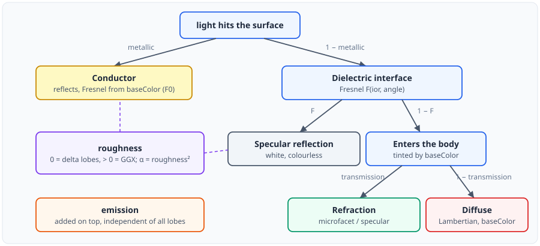
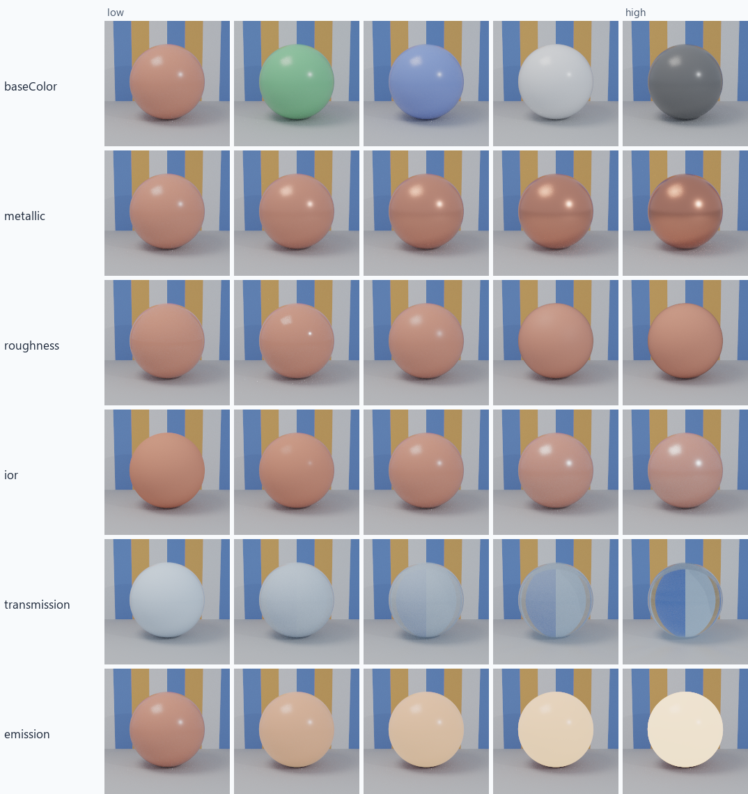
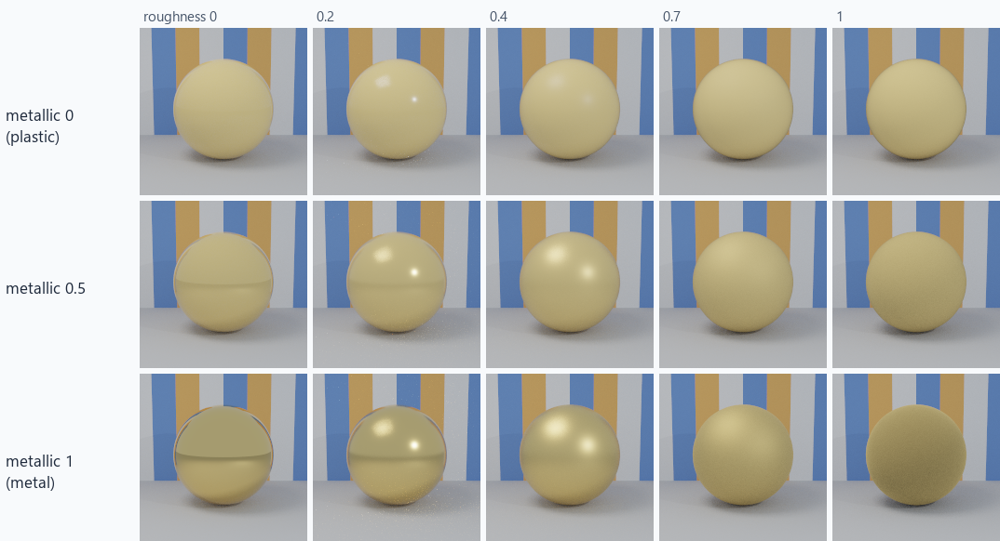
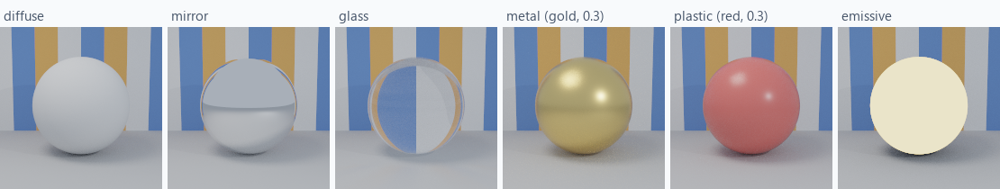
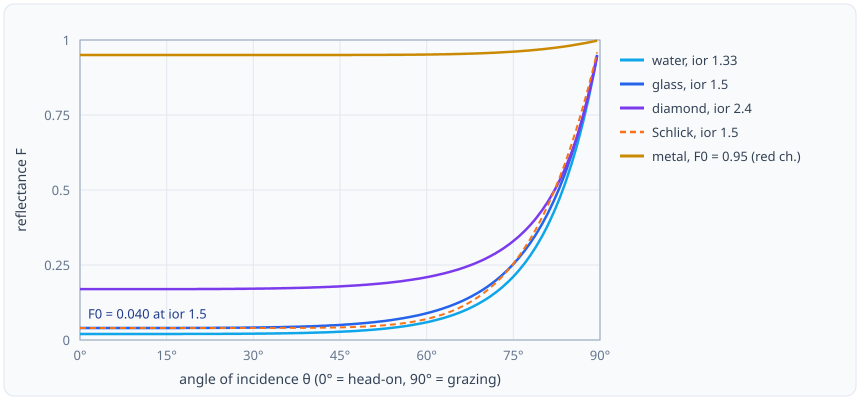
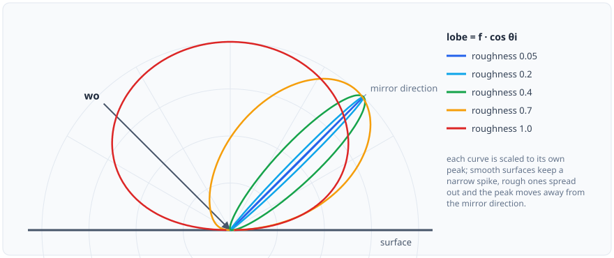
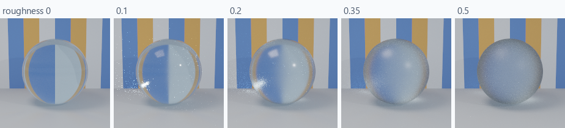
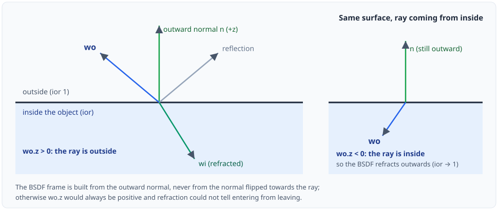

# Materials for Ray-Based Rendering

This document explains how the renderer describes a surface: which parameters a material has, what each
one means physically, why there are exactly six of them, and how they are turned into a scattering
function (BSDF) that a path tracer can sample. All renders in this document are produced by the
renderer itself (path tracing, same studio scene, one sphere per cell); the script that regenerates them
is `docs/figures/materials/make_material_figures.py`.

## Contents

1. [What a material has to answer](#1-what-a-material-has-to-answer)
2. [Why six parameters](#2-why-six-parameters)
3. [The six parameters](#3-the-six-parameters)
4. [Presets](#4-presets)
5. [From parameters to a BSDF](#5-from-parameters-to-a-bsdf)
6. [Fresnel: how much light reflects](#6-fresnel-how-much-light-reflects)
7. [Roughness and the GGX microfacet model](#7-roughness-and-the-ggx-microfacet-model)
8. [Transmission and refraction](#8-transmission-and-refraction)
9. [Conventions: frame, cosine and delta lobes](#9-conventions-frame-cosine-and-delta-lobes)
10. [Adding your own parameters](#10-adding-your-own-parameters)
11. [Limitations](#11-limitations)
12. [References](#12-references)

---

## 1. What a material has to answer

When a ray hits a surface, the integrator needs two things from the material:

- **Scattering**: given the direction the light leaves along (`wo`), which incoming directions `wi`
  contribute and how much (`f(wo, wi)`), and how to *choose* a direction `wi` with a known probability
  density (`sample`, `pdf`). This is the **BSDF** (bidirectional scattering distribution function).
- **Emission**: how much light the surface produces itself.

A material is therefore a *parameterisation* of a BSDF plus an emission term. The design question is
which parameters to expose. Too few and common surfaces cannot be expressed; too many, or overlapping
ones, and the same look can be reached in several ways, which makes materials hard to author, hard to
interpolate and hard to reason about.

## 2. Why six parameters

The parameter set is deliberately **minimal and linearly independent**: no parameter can be obtained
from the others. Following the principled / "uber" models used in production (Disney Principled BSDF,
OpenPBR, Autodesk Standard Surface, glTF PBR), every one of the common knobs was checked against that
rule, and three popular ones were dropped because they are redundant:

| Dropped | Why |
|---|---|
| `specular` / `specularLevel` | For a dielectric the reflectance at normal incidence is fixed by the refractive index: $F_0 = \left(\frac{n-1}{n+1}\right)^2$. Keeping both `specular` and `ior` would describe the same quantity twice. |
| `transmissionTint` | A transmitted ray that enters the body is tinted exactly like a diffuse one, so `baseColor` already says it. |
| `emissionStrength` | Scaling an HDR RGB `emission` colour by a number is just another HDR RGB colour. |

What remains is the smallest set that spans mirror, glass, metal, plastic, matte and light sources:

<p align="center"></p>

Everything not covered here (clear coat, sheen, subsurface, anisotropy, thin film...) is *not* hidden in
the base model: such a material is a new class that derives from `Material` and adds its own
parameters ([section 10](#10-adding-your-own-parameters)).

## 3. The six parameters

| Parameter | Type / default | Meaning |
|---|---|---|
| `baseColor` | RGB, 0.8 grey | Diffuse albedo of a dielectric, **or** normal-incidence reflectance $F_0$ of a metal. Also tints light that is transmitted through the body. |
| `metallic` | 0..1, 0 | 0 = dielectric (plastic, glass, ceramic), 1 = conductor (metal). Values in between blend the two. |
| `roughness` | 0..1, 1 | 0 = perfectly smooth (mirror-like delta lobes), 1 = very rough. The GGX width is $\alpha = \text{roughness}^2$. |
| `ior` | > 0, 1.5 | Index of refraction of the dielectric interface. `1` means *no interface*: no reflection and no bending, i.e. a purely diffuse surface. |
| `transmission` | 0..1, 0 | 0 = opaque dielectric, 1 = light passes through the body (glass). |
| `emission` | HDR RGB, 0 | Radiance leaving the surface in addition to whatever it scatters. |

Each row below varies one parameter and keeps the others at their default (a red, slightly glossy
dielectric, `roughness` 0.25, `ior` 1.5). The *transmission* row uses a light-blue, perfectly smooth
material so the refraction is visible.

<p align="center"></p>

Reading the figure:

- **baseColor** changes the tint of the diffuse body only; the white highlight is the dielectric
  reflection and does not take the body colour.
- **metallic** removes the diffuse body gradually and tints the reflection with `baseColor`: at 1 the
  sphere is a coloured mirror (here a copper-like one).
- **roughness** spreads the highlight from a sharp point (0.0 and 0.15) to a broad sheen (1.0).
- **ior** controls how reflective the dielectric interface is. At 1.0 there is no highlight at all; at
  2.4 (diamond) the reflection is strong and the body is visibly washed out.
- **transmission** turns an opaque coat into glass: the backdrop appears, flipped, through the sphere.
- **emission** adds light; the sphere stays shaded by the scene but glows.

### Metals and dielectrics

`metallic` is the only switch between two different physical behaviours, so it is worth being precise.

- A **dielectric** (plastic, glass, wood, paint) reflects a small, colourless fraction of the light at
  the interface (the amount depends on `ior` and on the angle, [section 6](#6-fresnel-how-much-light-reflects)).
  The rest enters the body, where it is either scattered back out diffusely (`baseColor` is the albedo)
  or refracted through (`transmission`).
- A **conductor** (gold, copper, aluminium) does not let light in. Everything is reflected, and the
  amount depends on wavelength, which is what gives metals their colour. That wavelength-dependent
  reflectance at normal incidence is `baseColor`.

The two together:

<p align="center"></p>

The top row is a gold-coloured plastic: a diffuse yellow body with a white highlight. The bottom row is
gold metal: no diffuse body, coloured reflections. The middle row is the 50 % blend. Roughness runs
left to right in every row.

## 4. Presets

There is no material "type"; the familiar materials are parameter values (`Material::diffuse`,
`mirror`, `glass`, `metal`, `plastic`, `emissive`):

| Preset | `baseColor` | `metallic` | `roughness` | `ior` | `transmission` | `emission` |
|---|---|---|---|---|---|---|
| `diffuse(albedo)` | albedo | 0 | 1 | **1** | 0 | 0 |
| `mirror(tint)` | tint | **1** | **0** | 1.5 | 0 | 0 |
| `glass(ior, tint)` | tint | 0 | **0** | ior | **1** | 0 |
| `metal(color, r)` | color | **1** | r | 1.5 | 0 | 0 |
| `plastic(color, r)` | color | 0 | r | 1.5 | 0 | 0 |
| `emissive(L, k)` | 0 | 0 | 1 | **1** | 0 | **L · k** |

<p align="center"></p>

`diffuse` and `emissive` set `ior = 1` so that they have no specular interface, which is what makes them
ideal Lambertian / pure emitters. In a scene description you can mix and match freely, for example a
rough, tinted glass or a dielectric with `transmission` 0.5.

## 5. From parameters to a BSDF

`Material::createBSDF()` assembles a **mixture of lobes**. Each lobe is a simple, well-understood
scattering function; the parameters decide which lobes exist and with what weight:

| Lobe | Created when | Weight | What it is |
|---|---|---|---|
| Conductor reflection | `metallic` > 0 | `metallic` | Fresnel (from `baseColor`) times a smooth or GGX reflection |
| Dielectric reflection | `ior` ≠ 1 | `1 − metallic` | White reflection, exact dielectric Fresnel |
| Refraction | `transmission` > 0, `ior` ≠ 1 | `(1 − metallic) · transmission` | Tinted by `baseColor` |
| Diffuse body | `transmission` < 1 | `(1 − metallic) · (1 − transmission)` | Lambertian with albedo `baseColor` |

Two details make the mixture energy-conserving rather than merely plausible:

- **The body only receives what the interface lets in.** The diffuse lobe is scaled by $1 - F(\theta_o)$,
  where $F$ is the dielectric Fresnel reflectance of the interface above it. Reflected light is not
  also scattered diffusely.
- **Lobe selection follows contribution.** When sampling, a lobe is chosen with probability
  proportional to its weight times its directional albedo (`BSDF::rho(wo)`), so an unimportant lobe is not
  sampled often just because it exists. The sampled direction's `pdf` is the mixture's `pdf`, and `f`
  is the sum of all non-delta lobes, which keeps the estimator unbiased and compatible with multiple
  importance sampling.

A smooth material (`roughness` below 0.03) uses *delta* lobes instead of GGX ([section 9](#9-conventions-frame-cosine-and-delta-lobes)).

## 6. Fresnel: how much light reflects

At an interface the fraction of light that is reflected, rather than transmitted, depends on the angle of
incidence. Everybody has seen this: a lake is transparent looking down, and a mirror near the horizon.

For a **dielectric** the renderer uses the exact unpolarised Fresnel equations for light going from
index 1 to index $n$:

$$F = \tfrac12\left(r_\perp^2 + r_\parallel^2\right),\quad
r_\perp = \frac{\cos\theta_i - n\cos\theta_t}{\cos\theta_i + n\cos\theta_t},\quad
r_\parallel = \frac{n\cos\theta_i - \cos\theta_t}{n\cos\theta_i + \cos\theta_t}$$

with $\sin\theta_t = \sin\theta_i / n$. The value at normal incidence is
$F_0 = \left(\frac{n-1}{n+1}\right)^2$: about 4 % for glass ($n = 1.5$), 2 % for water, 17 % for
diamond. For a **conductor** the exact equations need a complex index per wavelength; the renderer uses
Schlick's approximation with `baseColor` as the measured $F_0$:

$$F(\theta) \approx F_0 + (1 - F_0)\,(1 - \cos\theta)^5$$

<p align="center"></p>

Every curve goes to 1 at grazing angles: *all* surfaces become mirrors if you look at them from a
shallow enough angle. The dashed curve shows that Schlick's formula is a close match for the exact
dielectric equations, and the gold curve shows why a metal looks bright everywhere while a dielectric
only reflects near the silhouette.

## 7. Roughness and the GGX microfacet model

A real surface is never perfectly flat; it is a field of tiny facets. The **microfacet model** describes
a rough surface by the statistics of the facet normals, and reflection happens on the facets whose
normal is the half vector $\mathbf{h}$ between `wo` and `wi`. The reflection BSDF is

$$f_r(\omega_o, \omega_i) = \frac{D(\mathbf{h})\,G(\omega_o,\omega_i)\,F(\omega_o\!\cdot\!\mathbf{h})}
{4\,|\cos\theta_o|\,|\cos\theta_i|}$$

- $D$ is the **normal distribution function**: how many facets point along $\mathbf{h}$. The renderer
  uses GGX (Trowbridge-Reitz),
  $D(\mathbf{h}) = \dfrac{\alpha^2}{\pi\left(\cos^2\theta_h(\alpha^2 - 1) + 1\right)^2}$, with
  $\alpha = \text{roughness}^2$. GGX has long tails, which gives the soft halo around highlights seen in
  real materials.
- $G$ is the **shadowing-masking** term (Smith): facets hide each other, which matters at grazing angles
  and keeps the BSDF from adding energy.
- $F$ is the Fresnel term of the previous section.

Directions are sampled from the **distribution of visible normals** (Heitz 2018): only facets that
`wo` can actually see are drawn, which has far lower variance than sampling all normals.

<p align="center"></p>

The plot shows $f \cdot \cos\theta_i$ in the plane of incidence for a view direction 45° off the normal.
As roughness grows, the lobe stops being a spike around the mirror direction and spreads out; at
roughness 1 it is broad and its peak leaves the mirror direction and moves towards the normal, which is why
very rough surfaces look matte rather than shiny.

## 8. Transmission and refraction

With `transmission` > 0 the dielectric lets light through. Light changes direction at the interface
according to **Snell's law**,

$$n_1 \sin\theta_1 = n_2 \sin\theta_2,$$

with $n_1 = 1$ outside and $n_2 = $ `ior` inside (and swapped for a ray travelling from inside to
outside). When going from the denser to the thinner medium at a steep angle there is no solution:
**total internal reflection**, and the interface reflects all the light.

- A **smooth** interface (`roughness` below 0.03) refracts into exactly one direction. The share that
  goes through is $(1 - F)$, and radiance is scaled by $\eta^2$ because compressing the same energy
  into a different solid angle changes the radiance.
- A **rough** interface uses a *microfacet transmission* lobe: the same GGX distribution, but the facet
  normal now bends the ray (Walter et al. 2007). The refracted image becomes frosted.

<p align="center"></p>

Rough transmission is the hardest case for a path tracer (rays refract through two interfaces and
rarely find a light), so even at a high sample count the right-most spheres are still noisy.

## 9. Conventions: frame, cosine and delta lobes

BSDFs are evaluated in a **local frame** whose $+z$ axis is the surface normal. The normal is always the
**outward** one, not the normal flipped towards the ray: the sign of `wo.z` then says which side the ray is
on, and that is what decides between entering and leaving a transparent object.

<p align="center"></p>

Two conventions keep every integrator uniform:

- **`f` never contains the cosine.** A path's throughput is multiplied by $f\,|\cos\theta_i| / \text{pdf}$
  at every bounce. The cosine is applied by the integrator, in one place, for all materials.
- **Delta lobes** (mirror, smooth glass) are not functions that can be evaluated at arbitrary
  directions: they are non-zero only along a single direction. They are represented by returning
  $R / |\cos\theta_i|$ from `sample()` with `pdf` equal to the probability of choosing that lobe. The
  cosine factor then cancels, the weight is exactly $R$ divided by the selection probability, and
  integrators need no special case. `evaluate()` and `pdf()` return 0 for delta lobes (a light sampled
  by next-event estimation can never hit a mirror direction), and `isDelta()` lets an integrator skip
  light sampling for a surface that has nothing but delta lobes.

The non-physical integrators (simple, Whitted, volume ray marching) share one classic ambient + diffuse +
Blinn-Phong shading function which is derived from the same six parameters (the Phong exponent comes
from `roughness`, the specular strength from `ior`), so a scene looks consistent across techniques.

## 10. Adding your own parameters

The six parameters are the *base*, not a ceiling. A material that needs more (for example a clear coat)
is a subclass:

```cpp
class CoatedMaterial : public Material {
public:
    float coat = 0.0f;           // new parameter
    float coatRoughness = 0.05f; // new parameter

    std::unique_ptr<BSDF> createBSDF() const override {
        auto bsdf = Material::createBSDF();      // the six-parameter base
        // ... wrap / mix in a coat lobe
        return bsdf;
    }
};

builder.material(std::make_unique<CoatedMaterial>());   // the scene takes ownership
```

Because integrators only talk to the `Material` and `BSDF` interfaces, a derived material works with every
technique and every acceleration structure without changing them. `tests/test_materials.cpp` shows a
derived material used this way. A new *lobe* subclasses `BSDF` (`evaluate`, `sample`, `pdf`, and `rho`
for lobe selection).

## 11. Limitations

- **No textures.** Parameters are constants over a primitive; there is no UV-mapped `baseColor` or
  roughness map.
- **Isotropic roughness.** The GGX distribution has one $\alpha$; brushed-metal anisotropy needs a
  derived material.
- **Single-scattering microfacets.** Energy lost to facet-to-facet bounces is not added back, so very rough
  metals are slightly too dark.
- **Conductors use Schlick**, not the exact complex-index Fresnel.
- **Transmission is surface-only.** There is no volume absorption inside glass (no Beer-Lambert tint
  that grows with thickness); `baseColor` tints at the interface. For light scattering inside objects
  use the participating medium.
- **RGB, not spectral**: no dispersion.

## 12. References

- B. Burley, *Physically Based Shading at Disney* (SIGGRAPH 2012 course notes) and *Extending the Disney BRDF
  to a BSDF with Integrated Subsurface Scattering* (SIGGRAPH 2015).
- Academy Software Foundation, *OpenPBR Surface* specification.
- Khronos Group, *glTF 2.0* metallic-roughness material and `KHR_materials_transmission`.
- B. Walter, S. Marschner, H. Li, K. Torrance, *Microfacet Models for Refraction through Rough Surfaces*
  (EGSR 2007).
- E. Heitz, *Sampling the GGX Distribution of Visible Normals* (JCGT 2018).
- E. Heitz, *Understanding the Masking-Shadowing Function in Microfacet-Based BRDFs* (JCGT 2014).
- C. Schlick, *An Inexpensive BRDF Model for Physically-Based Rendering* (Eurographics 1994).
- M. Pharr, W. Jakob, G. Humphreys, *Physically Based Rendering: From Theory to Implementation*, chapters on
  reflection models and light transport.
